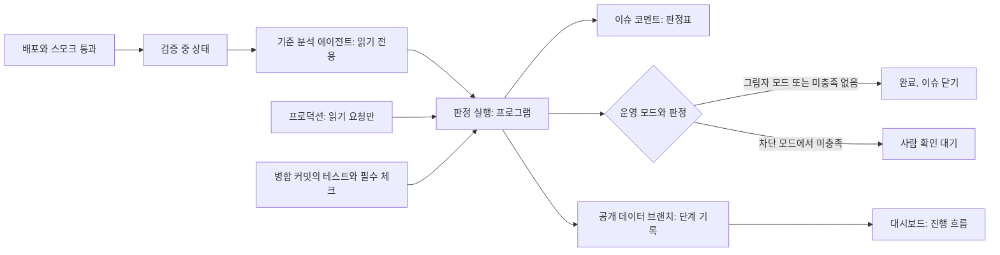
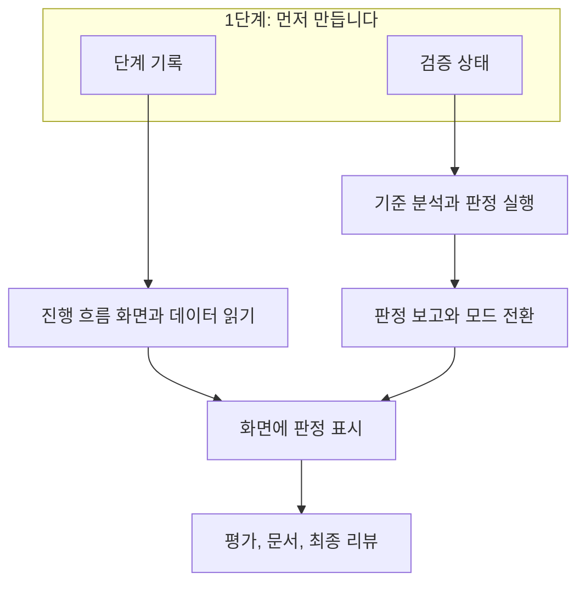

# 완료 검증 게이트와 이슈 진행 모니터링: 검토 계획

## Summary

팩토리는 지금 프로덕션 배포와 공통 스모크 테스트가 통과하면 이슈를 닫습니다. 스모크 테스트는 서비스 전체의 기본 동작만 확인하므로, 이슈가 요구한 수용 기준이 프로덕션에서 실제로 충족되었는지는 확인하지 않습니다. 또한 대시보드는 런이 끝난 뒤의 기록만 보여 주고 최대 5분 늦기 때문에, 지금 어떤 이슈가 어느 단계에서 멈췄는지 알기 어렵습니다. 이 계획은 두 문제를 함께 해결합니다. 배포 뒤에 이슈의 수용 기준을 하나씩 확인하는 단계를 추가하고, 기존 공개 대시보드에 이슈별 진행 흐름 화면을 추가합니다. 게이트는 처음에 판정만 기록하는 그림자 모드로 동작하므로, 오탐률을 확인하기 전에는 이슈 처리 방식이 바뀌지 않습니다.

## What you will get

- 대시보드 첫 화면에 열린 이슈별 진행 흐름이 나타납니다. 각 이슈의 현재 단계, 단계별 소요 시간, 수정 횟수, 멈춘 이유, 이슈·PR·실행 링크를 볼 수 있습니다.
- 사람의 조치를 기다리는 이슈가 맨 위에 모이고, 제한 시간을 넘긴 실행은 지연으로 표시됩니다.
- 화면은 탭이 보이는 동안 1분마다 갱신됩니다. 탭이 숨겨지면 갱신을 멈춥니다.
- 배포된 이슈마다 수용 기준별 판정표가 이슈 코멘트와 대시보드에 남습니다. 판정은 충족(프로덕션 확인), 충족(테스트 근거), 미충족, 확인 불가 중 하나입니다.
- 그림자 모드 결과를 보고 사람이 차단 모드로 전환할 수 있습니다. 차단 모드에서 미충족 이슈는 닫히지 않고 사람에게 넘어갑니다.
- 사람이 판정을 검토한 뒤 결과를 받아들여 이슈를 닫는 새 명령 `@factory accept`가 추가됩니다.

## What will be built

| Part | What it does | Size | Built by |
|---|---|---|---|
| 단계 기록 | 상태 전환과 에이전트 시작을 공개 데이터 브랜치에 기록하며, 기록이 실패해도 팩토리 진행을 막지 않습니다 | S | 신중한 담당자 |
| 진행 흐름 화면 | 기록을 읽어 이슈별 흐름, 소요 시간, 지연, 사람 차례를 그립니다 | M | 신중한 담당자 |
| 데이터 읽기와 갱신 | 1분 단위로 읽고, GitHub 요청 한도가 부족하면 5분 지연 경로로 자동 전환합니다 | S | 신중한 담당자 |
| 검증 상태 | 병합과 완료 사이에 "검증 중" 상태를 추가하고, 멈춘 이슈는 매시간 정리합니다 | S | 신중한 담당자 |
| 기준 분석 | 읽기 전용 에이전트가 수용 기준별로 확인 방법을 제안합니다 | M | 신중한 담당자 |
| 판정 실행 | 프로그램이 읽기 전용 요청과 테스트 근거를 직접 확인해 판정합니다 | M | 신중한 담당자 |
| 판정 보고와 모드 전환 | 판정표를 남기고, 그림자 모드와 차단 모드에 따라 이슈를 처리합니다 | S | 신중한 담당자 |
| 평가와 문서 | 평가 케이스, 운영 안내, 설계 문서, 변경 기록을 갱신합니다 | S | 빠른 담당자 |

## How it fits together

에이전트는 프로덕션에 요청을 보내지 못하고 판정도 내리지 못합니다. 수용 기준은 외부인이 쓴 이슈 본문에서 나올 수 있어, 악의적인 지시가 프로덕션을 변경하거나 판정을 조작할 위험이 있기 때문입니다. 에이전트는 확인 방법만 제안합니다. 프로그램은 프로덕션 API 주소로 보내는 로그인 없는 읽기 요청만 실행하고, 테스트 근거는 해당 테스트가 병합 변경에 포함되었고 필수 체크가 통과했을 때만 인정합니다.

## How it gets built

PR은 세 개로 나눕니다. 팩토리 규칙과 워크플로를 바꾸는 기록 PR과 게이트 PR은 T3이고, 화면 PR은 T1입니다. 기록이 배포되어야 화면을 실제 데이터로 확인할 수 있으므로 기록 PR을 먼저 병합합니다.

## Decisions you can change

- 커밋: 작업별 커밋으로 브랜치에 남기고 PR 직전에 정리합니다(기본) | 작업 중에는 커밋하지 않고 마지막에 묶습니다.
- 검증 에이전트: 구현 에이전트와 다른 도구를 쓰고 이슈당 1달러, 10분으로 제한합니다(기본) | 가장 저렴한 도구로 고정합니다.
- 확인 불가 판정: 이슈를 막지 않고 판정표와 대시보드에 표시합니다(기본) | 차단 모드에서 사람에게 넘깁니다.
- 검증 자체의 실패: 차단 모드에서는 사람에게 넘기고, 그림자 모드에서는 기록만 하고 닫습니다(기본) | 두 모드 모두 기록만 하고 닫습니다.
- 차단 모드 전환 기준: 그림자 모드 10건 이상에서 오탐이 1건 이하일 때 사람이 전환합니다(기본) | 다른 건수나 기간을 정합니다.
- 프로덕션 확인 재시도: 실패하면 5분 동안 세 번 시도합니다(기본) | 재시도하지 않습니다.
- 화면 공개 범위: 저장소가 공개이므로 이슈 번호, 제목, 상태, 시간, 고정된 사유 코드까지 공개합니다(기본) | 번호와 상태만 공개합니다.

## Risks

- 브라우저의 GitHub 요청 한도: 로그인 없는 요청은 IP당 시간당 60회입니다. 2026-11-05 시험에서 변경 없음 응답(304)도 남은 횟수를 줄이는 것으로 보였으므로(한 번의 측정), 조건부 요청으로 한도를 절약한다고 가정하지 않습니다. 탭 하나를 계속 띄우면 한도에 닿을 수 있어, 남은 횟수가 부족하면 5분 지연 경로로 자동 전환하고 화면에 표시합니다. 같은 IP의 여러 탭이나 사용자가 있으면 1분 갱신이 유지되지 않을 수 있습니다.
- 오탐: 잘못된 확인 방법이나 일시 장애로 미충족이 나올 수 있습니다. 그림자 모드, 재시도, 판정표의 근거 공개로 줄입니다.
- 약한 확인: 에이전트가 형식만 맞는 쉬운 확인 방법을 제안하면 충족 판정이 쉬워집니다. 판정표에 실제 요청과 기대값을 공개하고 평가 케이스로 점검하지만, 이 위험을 완전히 없애지는 못합니다.
- 확인 범위의 한계: 로그인이 필요한 동작과 브라우저 화면 동작은 프로덕션에서 확인하지 않으며, 테스트 근거 또는 확인 불가로 표시합니다.
- 멈춘 이슈: 검증 실행이 시작되지 못하면 이슈가 "검증 중"에 남을 수 있습니다. 매시간 도는 점검이 1시간을 넘긴 이슈를 현재 모드에 맞게 정리합니다.
- 기록 경합: 공개 데이터 브랜치에 쓰는 횟수가 늘어납니다. 기존 재시도 방식을 쓰고, 실패해도 상태 전환은 계속합니다. 이 경우 화면의 기록이 빠질 수 있습니다.
- 롤백 없음: 게이트는 이미 배포된 변경을 되돌리지 않으며, 사람이 판단할 정보를 제공합니다.

## Out of scope

- 에이전트 출력의 실시간 스트리밍과 별도 관제 서버, 화면에서 지시하기.
- 미충족 시 자동 수정이나 자동 롤백, 보완 이슈 자동 생성.
- 프로덕션 쓰기 검증과 로그인이 필요한 검증, 브라우저 화면 검증.
- 이슈의 작업 분해와 재계획 (앞서 제안한 다른 아이디어).
- 과거 이슈의 소급 검증. 기록 시작 전 이슈는 기존 런 기록으로만 표시합니다.

## How we will know it works

- 시험 이슈를 처리하는 동안 대시보드에서 단계가 바뀌는 것을 보고, 전환 후 약 2분 안에 반영되는지 확인합니다.
- GitHub 요청 한도를 소진한 상태를 재현하면 화면이 지연 경로로 전환되고 그 사실을 표시합니다.
- 사람 대기 이슈가 맨 위에 표시되고, 제한 시간을 넘긴 실행이 지연으로 표시됩니다.
- 그림자 모드에서 충족, 미충족, 확인 불가가 섞인 시험 이슈의 판정표가 남고 이슈는 지금처럼 닫힙니다.
- 차단 모드 시험에서 미충족 이슈가 열린 채 사람 확인 대기로 가고, `@factory accept`로 닫힙니다.
- 쓰기 요청, 다른 주소로 보내는 요청, 이슈 본문의 악의적 지시를 담은 평가 케이스가 모두 거부됩니다.
- 기존 전체 검사와 필수 체크가 모두 통과합니다.

## Rough time and cost

구현에 약 2-4시간, 에이전트 비용 약 $20-40으로 추정합니다. 구현 계획을 검사하기 전의 대략적인 값이며 실측이 아닙니다. 운영 비용은 이슈당 검증 상한인 1달러 이내로 제한합니다. PR별 사람 승인 시간과 그림자 모드 관찰 기간은 포함하지 않으며, 관찰 기간은 이슈 처리량에 따라 달라집니다.
