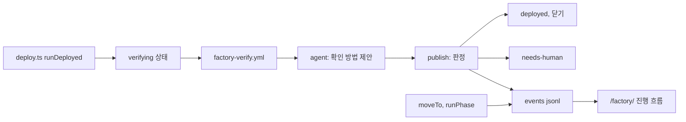
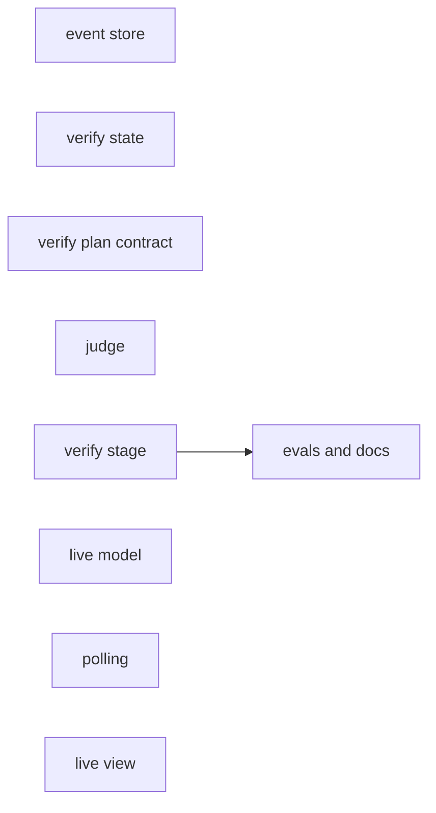

# 완료 검증 게이트와 이슈 진행 모니터링: 실행 계획

**Review plan:** docs/plans/2026-11-05-completion-gate-and-monitoring.review.md
**Goal:** 배포 뒤 수용 기준을 판정하는 게이트와, 이슈별 진행 흐름 대시보드를 추가한다.
**Architecture:** 팩토리가 상태 전환과 단계 시작을 `factory-data` 브랜치 `events/YYYY-MM.jsonl`에 남기고 정적 대시보드가 읽는다. 배포 뒤 `verifying` 상태에서 읽기 전용 에이전트가 확인 방법을 제안하고, publish 단계의 프로그램이 판정한다.
**Tech stack:** TypeScript, Vitest, zod, GitHub Actions, Vite 정적 페이지
**Spec:** docs/plans/2026-11-05-completion-gate-and-monitoring.review.md
**Detail:** contracts
**Target-min:** 25

Ruling: AI 오케스트레이터 - 승인 훅이 이 환경에서 기록하지 못해 사용자가 이 워크트리만 AI 모드로 선택했다 - 승인된 범위 밖 변경, push, 병합은 사람에게 묻는다.
Ruling: detail은 contracts - 계획 15k 상한을 지키기 위해서다 - 구현자가 테스트 세부를 직접 쓴다.

## Global constraints

- 언어와 테스트: TypeScript. `pnpm --filter factory test`, `pnpm --filter web test`. 전체는 `pnpm typecheck && pnpm lint && pnpm test`. 테스트를 먼저 쓴다.
- 기록 실패는 상태 전환을 막지 않는다(`syncBoard`와 같은 처리).
- 이벤트 한 줄 형식 `FactoryEvent`: `{ts: string, issue: number, kind: "state"|"start"|"verify", title?: string, from?: string, to?: string, role?: string, reason?: string, runUrl?: string, verdict?: {met: number, unmet: number, unverifiable: number}}`. `reason`은 고정 코드만 쓰고 자유 문장을 넣지 않는다.
- 운영 모드: 리포 변수 `FACTORY_VERIFY_MODE`, 값 `shadow`(기본, 그 밖의 값도 모두 shadow) 또는 `enforce`.
- 프로덕션 확인: GET만, `https://sfd-api.<workersSubdomain>.workers.dev` 고정. 경로는 `/api/`로 시작하고 `..`, `%2e`, `\`, `://`가 없어야 한다. 헤더와 자격 증명 없음, `redirect: "error"`, 요청당 10초, 본문 1 MB 상한. 실패 시 5분 안에 총 3회 시도한다.
- 판정 값: `met-production`, `met-test`, `unmet`, `unverifiable`. `unmet`은 프로덕션 확인 실패에서만 나온다. 나머지 문제는 모두 `unverifiable`이다.
- 사유 코드: `verify_unmet`, `verify_failed`, `verify_stuck`. 포스트모템 정책의 `stall.exclude`에 넣는다.
- 검증 예산: 역할 `verify`, 엔진 `same-as-review` 선택 규칙(구현 엔진과 다름), maxTurns 20, timeout 10분, maxUsd 1. 일일 구현 상한에 세지 않는다. 모델 ID는 기존 환경변수를 쓴다.
- 대시보드 읽기: `https://api.github.com/repos/roboco-io/the-software-factory-demo/contents/<path>?ref=factory-data`, `Accept: application/vnd.github.raw+json`, 인증 없음. 조건부 요청으로 한도를 절약한다고 가정하지 않는다.
- 사용자에게 보이는 문구는 한국어. 마크다운 범위는 `-`.

## Main diagram

## File structure

- `packages/factory/src/runs/events.ts`: 이벤트 추가
- `packages/factory/src/stages/common.ts`, `phased.ts`: 이벤트 기록 지점
- `packages/factory/src/state/machine.ts`, `stages/deploy.ts`, `guard.ts`, `command.ts`: 검증 상태와 `accept`
- `packages/factory/src/stages/verify-plan.ts`, `factory/prompts/verify.md`: 에이전트 출력 계약과 프롬프트
- `packages/factory/src/stages/verify-judge.ts`: 프로덕션 확인과 판정
- `packages/factory/src/stages/verify.ts`, `.github/workflows/factory-verify.yml`: 단계와 워크플로
- `apps/web/src/factory/live.ts`: 이벤트를 이슈별 진행으로 계산
- `apps/web/src/factory/poll.ts`: 읽기와 갱신 주기
- `apps/web/src/factory/liveView.ts`: 화면

## Task graph

```mermaid
%% schedule
gantt
  title Predicted schedule (mm:ss)
  dateFormat X
  axisFormat %M:%S
  section lane 1
  T2 verify state and accept :t2, 0, 161s
  section lane 2
  T5 verify stage and workflow :t5, 0, 141s
  T9 evals and docs :t9, 141, 95s
  section lane 3
  T4 judge :t4, 0, 111s
  section lane 4
  T8 live view :t8, 0, 111s
  section lane 5
  T6 live model :t6, 0, 106s
  section lane 6
  T1 event store :t1, 0, 104s
  section lane 7
  T3 verify plan contract :t3, 0, 104s
  section lane 8
  T7 polling :t7, 0, 104s
```

critical path: T5 → T9 (3.9 min) · peak width 8 · predicted build 3.9 min · predicted total ≈ 7.4 min (target ✓)

## Package: factory

App type: data pipeline, HTTP client, state. Categories: state, protocol, encoding.

**Probe entry:** call=packages/factory/src/stages/verify-judge.ts

### T1 event store · Complexity 3 · Est. context 30k
**Owns:** packages/factory/src/runs/events.ts, packages/factory/test/events.test.ts, packages/factory/src/stages/common.ts, packages/factory/src/stages/phased.ts, packages/factory/test/common.test.ts, packages/factory/test/phased.test.ts
**Components:** 1
**LOC owned:** 110
**Tests:** fast
**Kind:** design
**Model:** sonnet
**Produces:** appendEvent(gh: GitHubPort, event: FactoryEvent) -> Promise<void>
e.g. appendEvent(gh, {ts:"2026-11-06T00:00:00.000Z",issue:7,kind:"state",from:"merged",to:"verifying"}) -> `events/2026-11.jsonl`에 한 줄 추가
e.g. writeFile이 계속 ConflictError -> reject 없이 resolve
**Review Focus:** `test_conflict_retries_then_swallows`: 충돌 4회 뒤 resolve, `test_move_to_records_event`: moveTo가 from, to, title, runUrl을 기록, `test_failed_event_keeps_transition`: appendEvent가 실패해도 라벨이 바뀜, `test_phase_start_event`: prepare 또는 all에서 plan.issue가 있으면 `kind:"start", role:stage.name` 기록, plan이 null이면 기록하지 않음
**Steps:** 1 failing test, 2 run: FAIL, 3 implement, 4 run: PASS
**Notes:** `createRunStore`의 재시도 방식과 `MAX_APPEND_ATTEMPTS`, `DATA_BRANCH`를 재사용한다.

### T2 verify state and accept · Complexity 5 · Est. context 40k
**Owns:** packages/factory/src/state/machine.ts, packages/factory/test/machine.test.ts, packages/factory/src/stages/deploy.ts, packages/factory/test/deploy.test.ts, packages/factory/src/stages/guard.ts, packages/factory/test/guard.test.ts, packages/factory/src/stages/command.ts, packages/factory/test/command.test.ts, packages/factory/src/stages/deps.ts, packages/factory/test/bootstrap.test.ts
**Components:** 3
**LOC owned:** 180
**Tests:** fast
**Kind:** design
**Model:** sonnet
**Produces:** VERIFYING_MARKER(sha: string, ts: string) -> string
e.g. VERIFYING_MARKER("abc","2026-11-06T00:00:00.000Z") -> "<!-- factory:verifying sha=abc ts=2026-11-06T00:00:00.000Z -->"
**Produces:** finishVerified(deps: StageDeps, issue: number, sha: string) -> Promise<boolean>
e.g. finishVerified(deps, 7, "abc") -> verifying에서 deployed로 옮기고 이슈를 닫고 true
e.g. 이슈가 verifying이 아니면 -> false
**Produces:** Settings.verifyMode: "shadow" | "enforce"
**Review Focus:** `test_transitions`: merged→verifying(deploy), verifying→deployed(verify), verifying→needs-human(verify), needs-human→deployed(command) 허용, 그 밖의 actor 거부, `test_deployed_dispatches_verify`: runDeployed가 verifying으로 옮기고 마커 코멘트를 남긴 뒤 `factory-verify.yml`을 issue, sha로 dispatch하며 닫지 않음, `test_rerun_no_double_dispatch`: 같은 sha 마커가 있으면 다시 dispatch하지 않음, `test_guard_stuck_shadow`: 마커 ts가 1시간을 넘으면 shadow에서 deployed로 닫음, `test_guard_stuck_enforce`: enforce에서 needs-human과 `verify_stuck`, `test_accept_requires_writer`: `@factory accept`는 write 권한만 가능, `test_accept_requires_source_verify`: `source:verify` 라벨이 없으면 거부
**Steps:** 1 failing test, 2 run: FAIL, 3 implement, 4 run: PASS
**Notes:** Actor에 `verify` 추가. `runDeployFailed`는 그대로 둔다. guard는 열린 verifying 이슈를 코멘트 마커로 찾는다.

### T3 verify plan contract · Complexity 3 · Est. context 28k
**Owns:** packages/factory/src/stages/verify-plan.ts, packages/factory/test/verify-plan.test.ts, factory/prompts/verify.md, packages/factory/src/agents/types.ts, factory/agents.yml, packages/factory/src/config/agents.ts
**Components:** 1
**LOC owned:** 110
**Tests:** fast
**Kind:** design
**Model:** sonnet
**Produces:** VerifyPlanSchema.parse(raw: unknown) -> VerifyPlan
e.g. VerifyPlanSchema.parse({criteria:[{index:0,method:"probe",path:"/api/topics?limit=1",expectStatus:200,bodyIncludes:"topicsCount",reason:"목록"}]}) -> 같은 값
e.g. VerifyPlanSchema.parse({criteria:[{index:0,method:"test",testFile:"apps/api/test/a.test.ts",testName:"limit",reason:"단위"}]}) -> 같은 값
e.g. VerifyPlanSchema.parse({criteria:[{index:0,method:"none",reason:"로그인 필요"}]}) -> 같은 값
**Review Focus:** `test_rejects_unknown_method`: method `"post"` 거부, `test_extra_fields_stripped`, `test_prompt_has_input_boundary`: 프롬프트가 이슈 내용을 요구사항 데이터로만 다루고 쓰기 요청을 제안하지 말라고 적음
**Steps:** 1 failing test, 2 run: FAIL, 3 implement, 4 run: PASS
**Notes:** 역할 `verify`를 Role과 agents.yml에 추가한다. `factory/`와 스키마의 경로 안전 검사는 T4 판정이 다시 한다.

### T4 judge · Complexity 6 · Est. context 36k
**Owns:** packages/factory/src/stages/verify-judge.ts, packages/factory/test/verify-judge.test.ts
**Components:** 1
**LOC owned:** 170
**Tests:** fast
**Kind:** design
**Model:** sonnet
**Consumes:** VerifyPlanSchema.parse(raw: unknown) -> VerifyPlan (T3)
**Produces:** judgeCriteria(input: JudgeInput) -> Promise<CriterionVerdict[]>
e.g. probe 200이고 본문에 `topicsCount` 포함 -> [{index:0,verdict:"met-production",evidence:"GET /api/topics?limit=1 -> 200"}]
e.g. test 근거의 파일이 병합 파일에 있고 내용에 testName이 있으며 필수 체크 성공 -> [{index:0,verdict:"met-test",evidence:"apps/api/test/a.test.ts: limit"}]
e.g. 3회 모두 500 -> [{index:0,verdict:"unmet",evidence:"GET /api/x -> 500"}]
**Review Focus:** `test_rejects_post_and_foreign_host`: `https://evil.test/` 또는 `//evil.test`는 요청 없이 unverifiable, `test_rejects_traversal`: `/api/../admin`, `/api/%2e%2e/x`, `/api\\x`는 요청 없이 unverifiable, `test_redirect_error`: fetch 옵션에 `redirect:"error"`가 있고 redirect는 unmet이 아닌 unverifiable, `test_no_credentials`: fetch에 헤더와 토큰이 없음, `test_retry_three`: 일시 실패 후 3회째 성공이면 met-production, `test_body_cap`: 1 MB 초과 본문은 unverifiable, `test_missing_criterion`: 계획에 없는 기준은 unverifiable, `test_duplicate_index`: 같은 index의 첫 항목만 사용, `test_test_file_not_merged`: 병합 파일에 없으면 unverifiable, `test_checks_failed`: 필수 체크 실패면 unverifiable
**Steps:** 1 failing test, 2 run: FAIL, 3 implement, 4 run: PASS
**Notes:** `JudgeInput`은 `{plan, criteriaCount, apiOrigin, mergedFiles, requiredChecksOk, readFile, fetch, sleep}`이다. 판정은 이 함수에서만 만든다.

### T5 verify stage and workflow · Complexity 6 · Est. context 45k
**Owns:** packages/factory/src/stages/verify.ts, packages/factory/test/verify.test.ts, .github/workflows/factory-verify.yml, packages/factory/src/cli.ts, packages/factory/src/runs/store.ts, factory/postmortem-policy.yml
**Components:** 2
**LOC owned:** 210
**Tests:** fast
**Kind:** design
**Model:** sonnet
**Consumes:** judgeCriteria(input: JudgeInput) -> Promise<CriterionVerdict[]> (T4) · VerifyPlanSchema.parse(raw: unknown) -> VerifyPlan (T3) · finishVerified(deps: StageDeps, issue: number, sha: string) -> Promise<boolean> (T2) · appendEvent(gh: GitHubPort, event: FactoryEvent) -> Promise<void> (T1)
**Produces:** verifyStage: PhasedStage<{issue: number; sha: string}, VerifyRunPlan, VerifyOutcome>
**Review Focus:** `test_shadow_unmet_closes`: shadow 미충족은 판정표를 남기고 닫음, `test_enforce_unmet_needs_human`: enforce 미충족은 열린 채 needs-human, `source:verify`, 사유 `verify_unmet`, `test_enforce_agent_fail`: enforce에서 에이전트 실패는 needs-human과 `verify_failed`, `test_shadow_agent_fail_closes`, `test_no_criteria_closes`: 트리아지 기준이 없으면 "기준 없음"으로 닫고 에이전트를 실행하지 않음, `test_table_escapes_cells`: 기준 문구의 `|`와 줄바꿈과 멘션이 코멘트 표를 깨지 않음, `test_rerun_idempotent`: 같은 sha 판정 코멘트가 있으면 다시 쓰지 않음, `test_records_run_and_event`: 런 기록 role `verify`와 `kind:"verify"` 이벤트의 verdict 집계, `test_agent_phase_no_token`: agent job에 GitHub 토큰이 없고 readOnly가 true
**Steps:** 1 failing test, 2 run: FAIL, 3 implement, 4 run: PASS
**Notes:** 워크플로는 `factory-triage.yml`의 prepare, agent, publish 구조를 따른다. 트리아지 기준은 `review.ts` prepare와 같은 방법으로 읽는다. PR은 커밋 제목의 `(#N)`로 찾고, 필수 체크는 PR head SHA의 체크 런과 `riskPolicy.requiredChecks`로 판단한다. publish job에는 프로덕션 비밀을 주지 않는다.

## Package: web

App type: web UI. Categories: encoding(XSS), protocol, state.

**Probe entry:** call=apps/web/src/factory/live.ts

### T6 live model · Complexity 4 · Est. context 28k
**Owns:** apps/web/src/factory/live.ts, apps/web/src/factory/live.test.ts
**Components:** 1
**LOC owned:** 130
**Tests:** fast
**Kind:** design
**Model:** sonnet
**Produces:** liveIssues(events: FactoryEvent[], now: Date) -> LiveIssue[]
e.g. to:"needs-human" 이벤트 뒤 -> [{issue:7,state:"needs-human",needsHuman:true,delayed:false,stages:[...]}]
e.g. in-progress에서 start role:"implement"가 31분 전 -> [{issue:8,state:"in-progress",running:"implement",delayed:true}]
**Produces:** parseEvents(text: string) -> FactoryEvent[]
e.g. parseEvents('{"ts":"2026-11-06T00:00:00Z","issue":7,"kind":"state","to":"merged"}\nbad') -> 한 건
**Review Focus:** `test_sort_human_first`: needs-human, 지연, 최신 순, `test_excludes_closed`: deployed는 최근 완료로 분리, `test_future_ts_ignored`, `test_broken_lines_ignored`, `test_round_count`: in-review→in-progress 횟수, `test_delay_limits`: triage 5분, implement 30분, fix 20분, review 15분, verify 10분을 넘으면 지연
**Steps:** 1 failing test, 2 run: FAIL, 3 implement, 4 run: PASS
**Notes:** 제한 시간은 `factory/agents.yml` 값을 상수로 옮겨 적는다.

### T7 polling · Complexity 4 · Est. context 26k
**Owns:** apps/web/src/factory/poll.ts, apps/web/src/factory/poll.test.ts
**Components:** 1
**LOC owned:** 110
**Tests:** fast
**Kind:** design
**Model:** sonnet
**Produces:** loadEvents(now: Date, f: typeof fetch) -> Promise<EventLoad>
e.g. API 200, `X-RateLimit-Remaining: 40` -> {source:"api",remaining:40,text:"..."}
e.g. API 403 또는 남은 횟수 5 이하 -> raw 경로로 읽어 {source:"raw",remaining:null,text:"..."}
**Produces:** nextDelayMs(load: EventLoad) -> number
e.g. nextDelayMs({source:"api",remaining:40,text:""}) -> 60000
e.g. nextDelayMs({source:"raw",remaining:null,text:""}) -> 300000
**Produces:** startPolling(run: () => Promise<number>, doc: Document) -> () => void
**Review Focus:** `test_hidden_pauses`: 탭이 숨겨지면 예약하지 않음, `test_visible_runs_once`: 다시 보이면 한 번만 실행, `test_failure_keeps_previous`: 읽기 실패가 이전 화면을 지우지 않고 5분 뒤 재시도, `test_month_boundary`: 이번 달과 지난달 파일을 함께 읽음, `test_stop_clears_timer`
**Steps:** 1 failing test, 2 run: FAIL, 3 implement, 4 run: PASS

### T8 live view · Complexity 4 · Est. context 36k
**Owns:** apps/web/src/factory/liveView.ts, apps/web/src/factory/liveView.test.ts, apps/web/src/factory/main.ts, apps/web/src/factory/main.test.ts, apps/web/src/factory/view.ts, apps/web/src/factory/factory.css
**Components:** 1
**LOC owned:** 170
**Tests:** fast
**Kind:** design
**Model:** sonnet
**Consumes:** liveIssues(events: FactoryEvent[], now: Date) -> LiveIssue[] (T6) · parseEvents(text: string) -> FactoryEvent[] (T6) · loadEvents(now: Date, f: typeof fetch) -> Promise<EventLoad> (T7) · nextDelayMs(load: EventLoad) -> number (T7) · startPolling(run: () => Promise<number>, doc: Document) -> () => void (T7)
**Produces:** renderLivePanel(issues: LiveIssue[], load: EventLoad, now: Date) -> HTMLElement
**Review Focus:** `test_title_is_text`: 제목 ``가 텍스트로 표시됨, `test_empty_state`: 진행 이슈가 없음을 안내, `test_raw_notice`: raw 경로면 5분 지연을 표시, `test_links`: 이슈, PR, 실행 링크, 실행 링크는 `https://github.com/`만 허용, `test_verdict_counts`: verdict 집계 표시, `test_refresh_keeps_details`: 갱신이 나머지 패널을 다시 그리지 않음
**Steps:** 1 failing test, 2 run: FAIL, 3 implement, 4 run: PASS
**Notes:** 기존 `el`, `link`, `time`을 재사용한다. "실시간 상태 화면이 아닙니다" 문구를 실제 동작에 맞게 고친다. 패널은 처리 과정 안내보다 위에 둔다. 모바일 폭에서 가로 스크롤이 없어야 한다.

## Package: docs

### T9 evals and docs · Complexity 2 · Est. context 30k
**Owns:** factory/evals/verify-no-write/case.yml, docs/operations.md, docs/superpowers/specs/2026-10-11-software-factory-design.md, CHANGELOG.md, packages/factory/test/eval-cases.test.ts
**Components:** 1
**LOC owned:** 90
**Tests:** fast
**Kind:** mechanical
**Model:** haiku
**Review Focus:** `test_eval_case_loads`: 새 평가 케이스가 `factory/prompts/verify.md`의 문구 "쓰기 요청을 제안하지 않는다"를 확인
**Steps:** 1 failing test, 2 run: FAIL, 3 write, 4 run: PASS
**Notes:** 운영 안내에 `FACTORY_VERIFY_MODE`, `@factory accept`, 대시보드 지연, 차단 모드 전환 기준(10건 이상, 오탐 1건 이하, 사람이 전환), Projects 보드 옵션 추가를 위한 `bootstrap` 재실행을 적는다. 설계 문서 4.2에 `verifying`을 넣고 변경 기록은 미출시 절에 적는다.

## Review Focus

- factory, 프로덕션 확인: 쓰기 요청, 외부 주소, 경로 우회, redirect, 자격 증명 유출 불가. 이슈 본문의 지시가 판정을 바꾸지 못함. 보안 민감이므로 T4와 T5는 reviewer가 본다.
- factory, 상태: 재실행 멱등성, 연속 배포에서 앞선 커밋 이슈 처리, 멈춘 verifying 정리, shadow 모드에서 기존 동작 유지.
- web: 공개 입력의 XSS, 요청 한도 소진, 숨김 탭, 깨진 줄.

## Self-review

모든 검토 계획 부품이 T1-T9에 대응한다. 동시에 도는 작업은 파일을 공유하지 않는다. 범위 밖 항목은 작업에 넣지 않았다.
