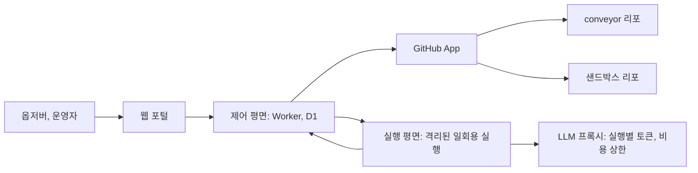

# 옵저버 플랫폼 피벗 설계

작성일: 2026-11-06. 상태: 제안이며 사용자의 확인을 기다린다. 구현은 시작하지 않았다.

## 1. 현재 상태와 목표

`roboco-io/the-software-factory-demo`는 지금 예제 서비스 conveyor(책 토론 포럼)와 이를 만드는 팩토리 런타임을 한 리포에 담고 있다. 팩토리는 GitHub Actions 위에서 돌고, 정책·프롬프트·단계 코드와 워크플로 약 30개 파일이 `apps/api`, `apps/web`, `tests/forum` 경로에 묶여 있다. 관찰 수단은 공개 정적 대시보드와 GitHub 이슈뿐이다. 그래서 방문자가 팩토리의 동작을 이해하려면 여러 화면을 오가야 하고, 다른 프로젝트에는 팩토리를 적용할 수 없다.

피벗의 목표는 이 리포를 여러 프로젝트를 관리하는 소프트웨어 팩토리 플랫폼으로 바꾸는 것이다. 일반 사용자는 GitHub로 로그인해 제한된 권한의 옵저버로 팩토리를 이해하고 체험한다. conveyor는 별도 리포의 관리 대상 프로젝트가 된다.

## 2. 사용자가 정한 것과 이 문서의 가정

사용자는 2026-11-06에 다음을 정했다. 옵저버는 샌드박스에서 사람의 승인 없이 에이전트 실행을 시작할 수 있다. 프로젝트는 rovr처럼 중앙 서버가 관리한다. conveyor는 Git 이력 없이 새 리포로 분리한다. 진행은 AI 오케스트레이터가 조율한다.

나머지는 이 문서의 가정이며 7절에서 바꿀 수 있다. 특히 "중앙 서버"를 제어 평면으로 해석한 점과, 샌드박스 공개를 보안 조건 뒤로 미룬 점은 확인이 필요하다.

rovr에 관한 내용은 2026-11-05에 화면에서 관찰한 동작만을 근거로 한다. rovr의 코드와 실행 로그는 볼 수 없었으므로 내부 구조를 따라 한다고 보장하지 않는다.

## 3. 구조

제어 평면은 Cloudflare Worker와 D1에 새로 만든다. 프로젝트, 이슈, 작업, 실행, 사용자 역할, 사용량을 저장하고 GitHub App 웹훅을 받는다. 이미 Workers와 D1을 운영하고 있어 새 운영 대상을 늘리지 않기 때문이다. 제약은 Worker가 코드 빌드나 에이전트를 직접 실행하기에 맞지 않다는 점이다. 그래서 에이전트는 실행 평면에서 돌린다.

실행 평면은 Cloudflare Sandbox SDK로 한다(3-1절). 제어 평면이 컨테이너 실행을 시작하고 결과를 받는다. 기존 팩토리 런타임의 단계 코드와 prepare, agent, publish 분리를 가능한 한 재사용하지만, Actions 전용 부분은 다시 만들어야 한다. Worker 안에서는 CLI 에이전트를 실행할 수 없다는 조사 결과가 근거다.

프로젝트 설정은 각 리포의 `.factory/`에 둔다. 위험 정책, 필수 체크, 프로덕션 스모크 대상, 예산, 프롬프트 추가 지침이 여기에 들어간다. 공통 프롬프트와 런타임은 플랫폼 리포가 소유한다. 지금처럼 경로를 코드에 고정하면 프로젝트마다 런타임을 고쳐야 하기 때문이다.

## 3-1. 실행 평면, 에이전트, 예산

사용자는 2026-11-06에 실행 평면을 Cloudflare Sandbox SDK로 정했다. 에이전트는 Claude Code 또는 Agent SDK와 pi이고, 각각 자기 API 키를 쓴다. Codex는 쓰지 않는다. OpenAI 크레딧이 API 키 Codex에 적용되지 않는다고 문서에 적혀 있기 때문이다. pi는 OpenAI 모델을 API 키로 호출한다. 이 호출이 크레딧에서 차감되는지는 작은 호출로 확인해야 하며, 확인 전까지는 가정이다. 구독 로그인은 쓰지 않는다. Anthropic이 제3자 서비스의 구독 자격 증명 사용을 금지하고, 두 회사의 크레딧도 API 키 사용에 적용되기 때문이다.

모델은 작업별 설정으로 고른다. 분류와 요약은 저비용 모델, 구현과 수정과 리뷰는 표준 모델을 기본으로 하고, 모델 ID는 설정값으로 둔다.

예산 기준은 각 계정의 월 크레딧 $100의 50%인 월 $50이다. 두 회사 모두 남은 크레딧을 읽는 공식 API를 2026-11-06 조사에서 찾지 못했다. 그래서 제어 평면이 실행별 사용량 기록과 관리자 키의 사용 금액 API로 지출을 계산하며, 이 값은 실제 잔액의 추정치다. Anthropic에는 전용 워크스페이스 지출 한도 $50을 안전장치로 건다. 실행 전 예약 금액을 포함해 판정해, 실행 중 초과를 줄인다.

전환 순서는 다음과 같다. Claude 지출이 $50에 도달하면 새 실행을 pi로 보낸다. 두 계정 모두 $50에 도달하면 새 실행을 시작하지 않고, 데모 사용자에게 안내 메시지를 표시하고, 팩토리 이슈를 청구 주기당 하나만 등록한다. 이 이슈는 예산을 쓰지 않도록 트리아지와 구현 대상에서 제외한다. 크레딧 주기와 API의 일 단위 집계가 달라 경계에 오차가 있고, Sandbox SDK와 pi 1.1.0 호환성, HTTPS 출구 필터링과 도구의 호환성은 구현 전 실험으로 확인한다.

사용자가 답하지 않은 항목의 기본값은 다음과 같다. 한 엔진만 남으면 T0, T1은 다른 모델과 새 세션으로 리뷰하고 그 사실을 표시하며, T2, T3은 다른 엔진 리뷰가 가능할 때까지 기다린다. 이 규칙은 플랫폼 전체에 적용하고, 샌드박스에는 별도 하위 한도를 둔다.

## 4. 사용자 역할과 인증

| 역할   | 조건                      | 할 수 있는 일                                               |
| ------ | ------------------------- | ----------------------------------------------------------- |
| 익명   | 로그인 없음               | 공개 소개 화면과 예시 실행 재생                             |
| 옵저버 | GitHub 로그인             | 모든 공개 프로젝트의 상태·기록 열람, 샌드박스 요청(쿼터 안) |
| 운영자 | 플랫폼 관리자 목록에 있음 | 프로젝트 등록, 일시 중지, 지시, T2·T3 승인                  |

로그인은 GitHub OAuth로 사용자 식별만 하고 최소 범위를 요청한다. 옵저버와 운영자의 GitHub 토큰은 신원 확인 뒤 저장하지 않는다. 리포 작업은 프로젝트에 설치된 GitHub App 토큰으로만 한다. rovr 로그인 화면은 운영자 토큰을 암호화 보관한다고 안내하는데, 이 설계는 App 권한으로 충분하다면 그 위험을 피하기 위해 다르게 한다.

옵저버 화면에는 에이전트 원문 로그와 비밀 값이 나타나지 않는다. 공개 이슈와 같은 수준의 내용과 구조화된 이벤트만 보여 준다. 실행 출력에 비밀이나 인젝션 문자열이 섞여 나올 수 있기 때문이다.

## 5. 옵저버 체험

체험의 중심은 포털 첫 화면의 프로젝트 목록과 이슈별 흐름이다. 각 이슈에서 요청, 분류, 계획, 구현, 교차 리뷰, 위험 등급, 병합, 배포, 완료 검증을 한 줄로 보고, 각 단계를 누르면 "왜 이 판단을 했는지"를 근거와 함께 읽는다. 로그인 전에도 기록된 실행을 재생해 볼 수 있다. 실행이 없을 때도 팩토리를 이해할 수 있어야 하기 때문이다.

샌드박스 요청은 정해진 작은 예제 앱에 대해서만 받는다. 옵저버가 짧은 요청을 쓰면 트리아지가 범위를 검사하고, 통과하면 구현, 리뷰, 프리뷰, 샌드박스 병합까지 자동으로 진행한다. 샌드박스 리포는 비밀과 프로덕션 연결이 없으며 주기적으로 초기 상태로 되돌린다.

## 6. 샌드박스 자동 실행의 보안 조건

이 기능은 이번 피벗에서 위험이 가장 크다. 지금의 팩토리는 외부인의 이슈가 사람의 `@factory go` 없이 구현되지 않는 것을 전제로 안전을 유지한다. 또한 구현 에이전트는 쓰기 권한으로 돌고 엔진 API 키를 환경변수로 받는다. 승인 없는 공개 입력을 이 구조에 그대로 넣으면, 인젝션된 에이전트가 키를 외부로 보내거나 비용을 소모할 수 있다.

그래서 다음 조건을 모두 충족하고 시험을 통과하기 전에는 공개하지 않는다.

- 실행 VM에는 실제 LLM 키를 주지 않는다. 실행마다 발급하는 단기 토큰과 비용 상한을 가진 LLM 프록시를 거친다.
- 실행 컨테이너의 네트워크 출구를 허용 목록(`allowedHosts`, `interceptHttps=true`)으로 제한한다. 문서상 지원되며, 실제 도구가 동작하는지 구현 전에 시험한다. 80, 443 외의 트래픽을 막기 위해 `enableInternet=false`도 확인한다.
- 샌드박스 리포와 실행에는 다른 프로젝트의 App 토큰, 프로덕션 비밀, 기존 팩토리 비밀을 주지 않는다.
- 제어 평면이 계정당·전체 일일 요청 수와 비용 상한을 강제하고, 상한에 닿으면 자동으로 멈춘다. 운영자는 즉시 전체 중지할 수 있다.
- 신규 GitHub 계정 제한과 악용 신고, 요청 내용 저장 기간을 정한다. 공개 자동 실행이 GitHub 이용 약관과 LLM 제공자 정책에 맞는지 공개 전에 사람이 확인한다.

이 조건을 줄여도 위험을 문서에 기록했을 뿐 위험이 줄지는 않는다. 조건을 충족하지 못하면 샌드박스는 운영자 승인 방식으로 공개한다.

## 7. 단계와 완료 조건

각 단계는 별도 PR 묶음이며 앞 단계가 끝나야 다음 단계로 간다. 플랫폼 리포의 팩토리 코드 변경은 T3이므로 PR마다 사람 승인이 필요하다.

| 단계                | 내용                                                                | 완료 조건                                                                           |
| ------------------- | ------------------------------------------------------------------- | ----------------------------------------------------------------------------------- |
| 1. 런타임 일반화    | 경로 고정을 `.factory/` 설정으로 옮긴다                             | 기존 동작 테스트가 설정만 바꾼 상태로 통과한다                                      |
| 2. conveyor 분리    | 이력 없이 `roboco-io/conveyor`를 만들고 배포·스모크·팩토리를 옮긴다 | 새 리포 PR이 프로덕션까지 배포되고 플랫폼 리포에 앱 코드가 없다                     |
| 3. 제어 평면과 인증 | OAuth, 역할, 프로젝트, 이벤트 수집을 만든다                         | 옵저버가 쓰기 작업을 할 수 없음을 API 테스트가 증명한다                             |
| 4. 옵저버 포털      | 프로젝트, 이슈 흐름, 판단 근거, 재생 화면을 만든다                  | 로그인한 사용자가 conveyor의 실제 이슈 흐름을 본다                                  |
| 5. 샌드박스 공개    | 샌드박스 리포, 프록시, 쿼터, 격리를 만든다                          | 6절의 조건을 인젝션 시험이 확인하고 사람이 공개를 승인한다                          |
| 6. 책 개정          | `roboco-io/the-software-factory`를 새 구조에 맞춰 전반적으로 고친다 | 책의 설명, 링크, 실습 경로가 실제 플랫폼과 conveyor 리포에 일치하고 사람이 검토한다 |

책 개정은 사용자가 2026-11-06에 범위에 추가했다. 2단계에서 URL과 리포 구조가 바뀌면 책의 링크가 먼저 깨질 수 있으므로, 2단계 병합 전에 책의 해당 링크만 먼저 고칠 수 있는지 확인한다. 전체 개정은 플랫폼의 동작이 확정되는 4-5단계 뒤에 한다. 책의 서술을 미리 바꾸면 구현과 어긋날 수 있기 때문이다.

중단한 완료 검증 게이트와 진행 모니터링은 브랜치 `worktree-completion-gate-monitoring-plan`에 있다. 이벤트 기록과 검증 판정은 포털의 재료이므로 1단계에 포함해 남은 테스트 실패를 고치는 것을 제안한다. 대시보드 화면 코드는 4단계에서 포털로 옮길지 판단한다.

## 8. 바꿀 수 있는 결정

- 실행 평면은 사용자 결정으로 Sandbox SDK다. 출구 제한이나 리소스 제한을 시험에서 통과하지 못하면 대안을 다시 묻는다.
- conveyor URL: 유지하지 않고 새 URL을 쓴다(사용자 결정, 2026-11-06). 구체적인 주소와 기존 포럼 데이터 이전 여부는 2단계 전에 정한다.
- 샌드박스 비용 상한: 전체 하루 $10, 계정당 하루 2건, 실행당 $1(기본, 실측 전 값) | 다른 값
- 플랫폼 리포 이름: 지금 이름 유지(기본) | 이름 변경
- 포털 주소: 새 하위 도메인 사용, 구체적인 이름은 사용자가 지정

## 9. 위험과 영향

- 외부 링크: README에 따르면 책이 이 리포를 구현 예제로 인용한다. conveyor의 기존 URL을 유지하지 않으므로 기존 링크는 깨지며, 6단계의 책 개정이 이를 해결한다. conveyor 코드를 이력 없이 옮기면 기존 PR과 커밋에서 새 리포로 이어지는 추적은 끊긴다. 플랫폼 리포에 기존 이력이 남고, 새 리포 첫 커밋에 원본 커밋을 적어 완화한다.
- 열린 작업: 2026-11-06 기준 열린 이슈 9건 이상과 PR 6건이 있고, 일부는 현재 구조를 전제로 한다. 2단계 전에 사람이 각각 옮기거나 닫을지 정해야 한다.
- 규모: 이 피벗은 사실상 새 제품이다. 단계별 기간과 비용은 1단계 실측 전에는 추정하지 않는다.
- 팩토리 중단: 1-2단계 동안 팩토리 자체를 바꾸므로, 전환 시점에는 `FACTORY_PAUSED`로 자동 실행을 멈춘다.

## 10. 범위 밖

결제, 조직별 멀티 테넌트, 외부 사용자의 자체 리포 등록, 옵저버의 실제 프로젝트 쓰기는 이번 피벗에 넣지 않는다. 사용자가 요청하지 않았고 위험과 범위를 크게 늘리기 때문이다.
