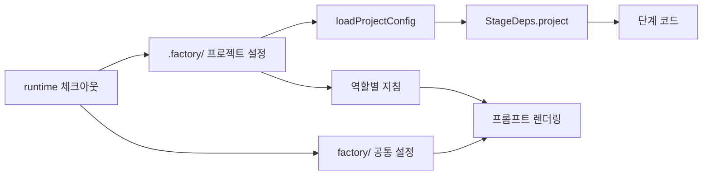
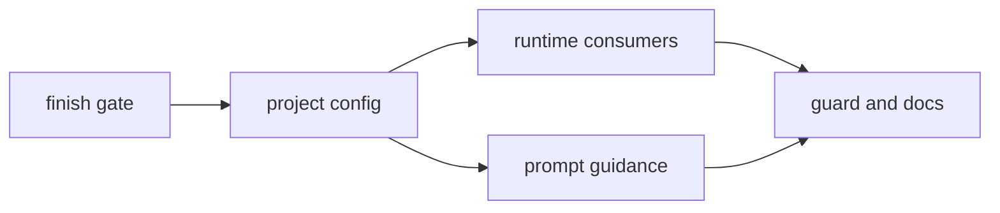

# 피벗 1단계: 런타임 일반화 실행 계획

**Goal:** 팩토리 런타임에서 conveyor 고유 경로와 값을 프로젝트 설정 `.factory/`로 옮기고, 완료 검증 게이트의 남은 작업을 끝낸다.
**Architecture:** 런타임은 신뢰할 수 있는 기본 브랜치 체크아웃의 프로젝트 디렉토리에서 설정을 읽는다. 공통 프롬프트와 역할 설정은 `factory/`에 남고, 프로젝트 정책과 지침은 `.factory/`로 옮긴다.
**Tech stack:** TypeScript, Vitest, zod, yaml, picomatch
**Spec:** docs/plans/2026-11-06-observer-platform-pivot.md
**Detail:** contracts
**Target-min:** 20

Ruling: conveyor 값은 그대로 `.factory/`에 둔다 - 1단계 완료 조건이 동작 불변이다 - 2단계에서 파일을 새 리포로 옮긴다.
Ruling: 워크플로 분리는 1단계에 넣지 않는다 - 런타임 호출 방식은 2단계 조건에 달렸다 - 2단계 범위가 커진다.

## Global constraints

- 테스트: `pnpm --filter factory test`. 전체 검사: `pnpm typecheck && pnpm lint && pnpm test`. 테스트를 먼저 쓴다.
- 기존 동작은 바뀌지 않는다. 기존 테스트의 기대값은 경로 이동에 필요한 경우에만 바꾼다.
- 보안: 프로젝트 설정은 `FACTORY_PROJECT_DIR`(기본 `REPO_ROOT`)에서만 읽고 `FACTORY_WORKDIR`(PR 코드가 있는 곳)에서 읽지 않는다. 워크플로의 `runtime/` 기본 브랜치 체크아웃이 그 근거다.
- `.factory/**`는 T3다. `risk-policy.yml`의 T3 규칙과 CODEOWNERS에 함께 넣는다.
- 설정 형식 오류와 알 수 없는 키는 예외로 거부한다. 조용히 기본값을 쓰지 않는다.
- `.factory/project.yml` 형식:

```yaml
name: conveyor
deployment:
  apiOrigin: "https://sfd-api.{workersSubdomain}.workers.dev"
  webUrl: "https://roboco.io/the-software-factory-demo/"
  previewWeb: "{webUrl}pr-preview/pr-{pr}/"
  previewApi: "https://sfd-api-pr-{pr}.{workersSubdomain}.workers.dev"
paths:
  skipFiles: [tests/forum/skip.txt]
  smokePaths: [tests/smoke/, apps/web/e2e-smoke/]
  migrationsDir: apps/api/migrations/
  protected:
    [
      ".github/",
      "factory/",
      ".factory/",
      "packages/factory/",
      "AGENTS.md",
      "CLAUDE.md",
      "scripts/",
      "tests/forum/vendor/",
      "tests/smoke/",
      "apps/web/e2e-smoke/",
    ]
evidence:
  testFilePatterns: ["apps/*/test/**", "**/*.test.ts", "**/*.test.tsx", "apps/web/e2e/**"]
  suites:
    - { suite: api, filter: api, dir: apps/api/ }
    - { suite: web, filter: web, dir: apps/web/ }
    - { suite: factory, filter: factory, dir: packages/factory/ }
  e2eDir: apps/web/e2e/
```

## Main diagram



## File structure

- `.factory/project.yml`, `.factory/risk-policy.yml`, `.factory/guidance/<role>.md`: conveyor 프로젝트 설정
- `packages/factory/src/config/project.ts`: 설정 스키마와 로더
- `packages/factory/test/fixtures/other-project/.factory/`: conveyor가 아닌 시험 프로젝트
- `packages/factory/test/no-project-literals.test.ts`: 런타임에 프로젝트 경로가 남지 않았는지 확인

## Task graph



Ruling: sequential - T1은 테스트 파일을 정리하고 T2는 모든 단계가 쓰는 의존성을 바꾼다 - 병렬화 이득이 작다.

## Package: factory

App type: data pipeline, state. Categories: state, protocol, file.

**Probe entry:** call=packages/factory/src/config/project.ts

### T1 finish gate · Complexity 4 · Est. context 40k

**Owns:** packages/factory/test/bootstrap.test.ts, packages/factory/test/postmortem-policy.test.ts, packages/factory/test/workflows.test.ts, packages/factory/test/scenario.test.ts, packages/factory/test/prompt.test.ts, packages/factory/src/stages/deploy.ts, packages/factory/test/deploy.test.ts, factory/prompts/verify.md, packages/factory/test/verify-plan.test.ts, factory/evals/verify-no-write/case.yml
**Components:** 2
**LOC owned:** 110
**Tests:** fast
**Kind:** design
**Model:** sonnet
**Produces:** runDeployed(deps: StageDeps, input: {sha: string}) -> Promise<number[]>
**Review Focus:** `test_marker_before_move`: 마커 코멘트가 실패하면 상태가 merged로 남고 재실행이 복구함, `test_scenario_reaches_deployed`: 시나리오가 verify 뒤 deployed에 도달함, `test_prompt_requires_body_check`: verify 프롬프트가 프로덕션 확인에 응답 내용 조건을 요구함, `test_eval_case_loads`: 평가 케이스가 "쓰기 요청을 제안하지 않는다"를 확인함
**Steps:** 1 failing test, 2 run: FAIL, 3 implement, 4 run: PASS
**Notes:** 현재 실패: 라벨 수 32, 포스트모템 제외 사유 3개, 워크플로 목록의 `factory-verify.yml`, 시나리오 2건, 프롬프트 Record의 verify 항목. `pnpm --filter factory test`와 tsc가 모두 통과해야 끝난다.

### T2 project config · Complexity 5 · Est. context 42k

**Owns:** packages/factory/src/config/project.ts, packages/factory/test/project-config.test.ts, packages/factory/src/paths.ts, packages/factory/src/main.ts, packages/factory/src/stages/deps.ts, packages/factory/test/helpers.ts, packages/factory/src/policy/risk.ts, packages/factory/test/risk.test.ts, packages/factory/test/codeowners.test.ts, packages/factory/test/ci-security.test.ts, packages/factory/test/risk-stage.test.ts, .factory/project.yml, .factory/risk-policy.yml, .github/CODEOWNERS, packages/factory/test/fixtures/other-project/.factory/project.yml, packages/factory/test/fixtures/other-project/.factory/risk-policy.yml

**Components:** 2

**LOC owned:** 170

**Tests:** fast

**Kind:** design

**Model:** sonnet

**Produces:** loadProjectConfig(dir: string) -> ProjectConfig
e.g. `loadProjectConfig("packages/factory/test/fixtures/other-project") -> {name:"other",paths:{skipFiles:[],smokePaths:["smoke/"],migrationsDir:null,protected:[".factory/"]},evidence:{suites:[{suite:"app",filter:"app",dir:"src/"}],e2eDir:null,testFilePatterns:["src/**/*.test.ts"]}}`
e.g. loadProjectConfig("/없는/경로") -> throws Error

**Produces:** renderDeploymentUrl(template: string, vars: {workersSubdomain?: string; webUrl?: string; pr?: number}) -> string
e.g. renderDeploymentUrl("https://sfd-api-pr-{pr}.{workersSubdomain}.workers.dev", {workersSubdomain:"roboco",pr:7}) -> "https://sfd-api-pr-7.roboco.workers.dev"

**Produces:** projectDir(env: NodeJS.ProcessEnv) -> string
e.g. projectDir({FACTORY_PROJECT_DIR:"/x"}) -> "/x"

**Review Focus:** `test_rejects_unknown_key`, `test_rejects_workdir_as_project_dir`: `FACTORY_PROJECT_DIR`가 `FACTORY_WORKDIR`와 같거나 그 아래면 buildDeps가 거부함, `test_unknown_template_var_throws`, `test_pr_must_be_positive_integer`, `test_policy_t3_includes_dot_factory`, `test_agent_phase_loads_config`: agent 단계도 토큰 없이 로드함

**Steps:** 1 failing test, 2 run: FAIL, 3 implement, 4 run: PASS

**Notes:** `git mv factory/risk-policy.yml .factory/risk-policy.yml`. `StageDeps`에 `project: ProjectConfig` 추가. `loadSettings`의 저장소 기본값은 유지한다. `webUrl`은 환경변수가 없으면 프로젝트 설정 값을 쓴다.

### T3 runtime consumers · Complexity 5 · Est. context 45k

**Owns:** packages/factory/src/stages/risk.ts, packages/factory/src/stages/gate.ts, packages/factory/src/stages/worktree.ts, packages/factory/src/stages/verify.ts, packages/factory/src/stages/verify-judge.ts, packages/factory/test/verify-judge.test.ts, packages/factory/test/verify.test.ts, packages/factory/src/stages/postmortem.ts, packages/factory/src/stages/evidence.ts, packages/factory/src/policy/evidence.ts, packages/factory/test/evidence.test.ts, packages/factory/src/report/pr.ts
**Components:** 2
**LOC owned:** 150
**Tests:** fast
**Kind:** design
**Model:** sonnet
**Consumes:** loadProjectConfig(dir: string) -> ProjectConfig (T2) · renderDeploymentUrl(template: string, vars: {workersSubdomain?: string; webUrl?: string; pr?: number}) -> string (T2)
**Produces:** planSuites(files: string[], evidence: ProjectConfig["evidence"]) -> {runs: SuiteRun[]; unsupported: string[]}
e.g. planSuites(["apps/api/test/a.test.ts"], conveyorEvidence) -> {runs:[{suite:"api",filter:"api",targets:["test/a.test.ts"]}],unsupported:[]}
**Review Focus:** `test_judge_origin_exact_match`: `apiOrigin`이 프로젝트 설정으로 렌더링한 값과 정확히 같아야 하고 https가 아니면 unverifiable, `test_skip_guard_from_config`, `test_empty_skip_files_no_guard`, `test_null_migrations_no_revert_block`: `migrationsDir`가 null이면 해당 검사를 건너뜀, `test_other_project_evidence`: 시험 프로젝트 설정으로 suite를 계획함, `test_required_checks_text_from_policy`: PR 보고서 문구가 정책의 필수 체크를 씀
**Steps:** 1 failing test, 2 run: FAIL, 3 implement, 4 run: PASS
**Notes:** `SuiteName`은 string으로 넓힌다. `E2E_DIR`, `SUITES`, `TEST_FILE_PATTERNS`, `SKIP_FILES`, `MIGRATIONS`, 프리뷰 URL 문자열을 설정으로 대체한다.

### T4 prompt guidance · Complexity 3 · Est. context 32k

**Owns:** packages/factory/src/agents/prompt.ts, factory/prompts/implement.md, factory/prompts/fix.md, factory/prompts/triage.md, factory/prompts/review.md, .factory/guidance/triage.md, .factory/guidance/review.md, packages/factory/src/stages/implement.ts, packages/factory/src/stages/fix.ts, packages/factory/src/stages/triage.ts, packages/factory/src/stages/review.ts, packages/factory/src/stages/eval-live.ts, packages/factory/src/policy/improve-paths.ts, packages/factory/test/prompt-guidance.test.ts, factory/evals/error-format/case.yml, factory/evals/threat-model-review/case.yml, factory/evals/threat-model-implement/case.yml
**Components:** 1
**LOC owned:** 120
**Tests:** fast
**Kind:** design
**Model:** sonnet
**Consumes:** loadProjectConfig(dir: string) -> ProjectConfig (T2)
**Produces:** loadGuidance(role: PromptName, dir: string) -> string
e.g. loadGuidance("triage", ".") -> `.factory/guidance/triage.md` 내용
e.g. loadGuidance("fix", "/fixture") -> ""
**Review Focus:** `test_guidance_in_rendered_prompt`, `test_missing_guidance_empty`, `test_protected_paths_from_config`: 구현 프롬프트의 수정 금지 경로가 `paths.protected`에서 옴, `test_guidance_is_not_escaped_as_issue_data`: 지침이 이슈 데이터 구분자 밖에 있음, `test_improve_can_edit_guidance`, `test_eval_cases_still_pass`
**Steps:** 1 failing test, 2 run: FAIL, 3 implement, 4 run: PASS
**Notes:** 포럼·오류 헬퍼·skip.txt 문장은 지침 파일로 옮긴다. 평가 케이스가 참조하는 파일 경로는 옮긴 위치에 맞춘다. 렌더링 결과의 지시 내용은 conveyor에서 그대로여야 한다.

### T5 guard and docs · Complexity 2 · Est. context 30k

**Owns:** packages/factory/test/no-project-literals.test.ts, AGENTS.md, docs/operations.md, docs/superpowers/specs/2026-10-11-software-factory-design.md, CHANGELOG.md, factory/evals/README.md
**Components:** 1
**LOC owned:** 80
**Tests:** fast
**Kind:** design
**Model:** sonnet
**Consumes:** planSuites(files: string[], evidence: ProjectConfig["evidence"]) -> {runs: SuiteRun[]; unsupported: string[]} (T3) · loadGuidance(role: PromptName, dir: string) -> string (T4)
**Review Focus:** `test_no_project_literals`: `packages/factory/src`와 `factory/prompts`에 `apps/`, `tests/forum`, `sfd-api`, `sfd-prod`, `conveyor`가 없고 예외는 근거와 함께 허용 목록에 있음, `test_other_project_end_to_end`: 시험 프로젝트 설정으로 위험 등급과 프롬프트 렌더링이 conveyor 값 없이 동작함
**Steps:** 1 failing test, 2 run: FAIL, 3 write, 4 run: PASS
**Notes:** 운영 문서에 `FACTORY_VERIFY_MODE`, `@factory accept`, verifying 상태, `.factory/` 구조, 그림자 모드에서 차단 모드 전환 기준(10건 이상, 오탐 1건 이하, 사람이 전환), `bootstrap` 재실행을 적는다. AGENTS.md와 설계 문서 4.2를 갱신한다. 변경 기록은 미출시 절에 적는다.

## Review Focus

- 설정 신뢰 경계: PR 코드가 정책, 지침, 프로덕션 주소를 바꿀 수 없음. 위험 정책 이동 뒤에도 T2·T3 판정과 CODEOWNERS 검사가 같음.
- 동작 불변: conveyor의 위험 등급, 필수 체크, evidence, 프롬프트 지시가 그대로임.

## Self-review

T1-T5가 설계 7절의 1단계와 중단한 게이트의 남은 항목을 다룬다. 리포 생성, 앱 코드 이동, 워크플로 분리는 포함하지 않는다.
